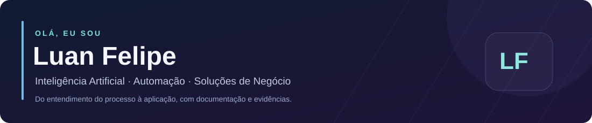
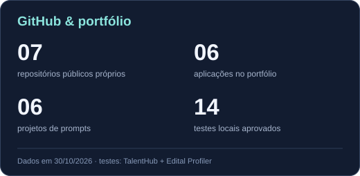
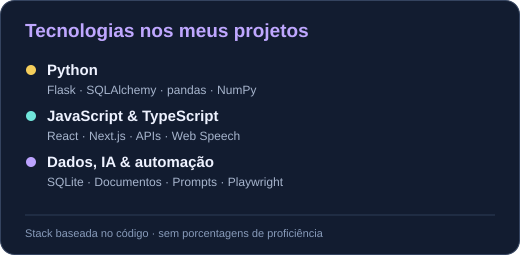

### Bem-vindo ao meu GitHub! 👋

Transformo necessidades de processos corporativos em **aplicações, automações e projetos de IA**.  
Busco oportunidades de **Analista de IA Júnior e Automação com IA**.

  

  

Ícones: <a href="https://skillicons.dev">Skill Icons</a> · Ferramentas presentes nos projetos do portfólio

## Sobre mim

Minha experiência com processos corporativos orienta como construo soluções: **entender o problema, definir regras, organizar dados e documentar a entrega**. Tenho interesse em conectar contexto de negócio, IA aplicada e desenvolvimento de aplicações úteis.

## 🚀 Projetos principais

### 01 · Edital Profiler v3

**Editais, recuperação de contexto e organização documental.** Aplicação para estruturar perfis, pesquisar informações em PDF/Word e acompanhar profissionais e documentos por processo.

`Python` `Flask` `SQLAlchemy` `SQLite` `NumPy` `Playwright` `MSAL`

**Evidência:** 3 testes locais aprovados, incluindo o fluxo com documentos de teste.  
[Conhecer o projeto e as telas](https://github.com/matosluan93/ai-business-solutions-portfolio/tree/main/applications/edital-profiler) · [Código privado](https://github.com/matosluan93/edital-profiler)

### 02 · TalentHub v2

**Recrutamento e gestão em uma plataforma web.** Vagas, candidatos, pipeline, três perfis de acesso, indicadores e recuperação de contexto com fontes.

`Python` `Flask` `SQLAlchemy` `SQLite` `MSAL` `NumPy`

**Evidência:** 11 testes locais aprovados de autenticação, permissões e fluxos da aplicação.  
[Conhecer o projeto e as telas](https://github.com/matosluan93/ai-business-solutions-portfolio/tree/main/applications/talenthub) · [Código privado](https://github.com/matosluan93/talenthub)

### 03 · SpeakAI

**Aprendizagem de idiomas com uma jornada interativa.** Oito idiomas, trilha executiva, gramática, gamificação, voz no navegador e progresso salvo localmente.

`JavaScript` `HTML` `CSS` `Node.js` `Web Speech API` `localStorage`

**Evidência:** telas da aplicação e build local verificado; conversação com IA depende da configuração do servidor.  
[Conhecer o projeto e as telas](https://github.com/matosluan93/ai-business-solutions-portfolio/tree/main/applications/speakai) · [Código privado](https://github.com/matosluan93/speakai-projeto)

> As apresentações públicas mostram escopo, telas e estágio de cada integração. O código dos três projetos principais permanece privado.

## 🧩 Mais aplicações e prompts

| Aplicação | Foco |
| :--- | :--- |
| [BenefProcess](https://github.com/matosluan93/ai-business-solutions-portfolio/tree/main/applications/benefprocess) | Bases de benefícios, validação e relatórios com Python, Flask e pandas |
| [Stefanini Shopping](https://github.com/matosluan93/ai-business-solutions-portfolio/tree/main/applications/stefanini-shopping) | E-commerce, catálogo e interface responsiva com Next.js e TypeScript |
| [NF-e — Automação](https://github.com/matosluan93/ai-business-solutions-portfolio/tree/main/applications/nfe-automation) | Protótipo local de cadastro, consulta e painel com Flask e SQLite |

**Prompts de IA:** [Gestor Acolhe](https://github.com/matosluan93/ai-business-solutions-portfolio/tree/main/prompts/gestor-acolhe) · [Sophie Voice Comms](https://github.com/matosluan93/ai-business-solutions-portfolio/tree/main/prompts/sophie-voice-comms) · [SmartComms](https://github.com/matosluan93/ai-business-solutions-portfolio/tree/main/prompts/smartcomms) · [SpeakAI](https://github.com/matosluan93/ai-business-solutions-portfolio/tree/main/prompts/speakai) · [LexAnalyzer](https://github.com/matosluan93/ai-business-solutions-portfolio/tree/main/prompts/lexanalyzer) · [SkillMatch](https://github.com/matosluan93/ai-business-solutions-portfolio/tree/main/prompts/skillmatch)

[Explorar aplicações](https://github.com/matosluan93/ai-business-solutions-portfolio/tree/main/applications) · [Explorar prompts](https://github.com/matosluan93/ai-business-solutions-portfolio/tree/main/prompts)

## 🛠️ Ferramentas, tecnologias e conhecimentos

| Frente | Conhecimentos aplicados nos projetos |
| :--- | :--- |
| **Backend e dados** | Python · Flask · SQLAlchemy · SQLite · pandas · NumPy · APIs REST |
| **Front-end** | HTML · CSS · JavaScript · TypeScript · React · Next.js · Tailwind CSS |
| **Documentos e automação** | pdfplumber · pypdf · python-docx · openpyxl · xlsxwriter · python-pptx · Playwright |
| **IA e integrações** | Engenharia de prompts · Recuperação de contexto · Groq · Azure OpenAI · Anthropic · MSAL · Microsoft Graph |
| **Qualidade e negócio** | Git · GitHub · pytest · Requisitos · Regras de negócio · Rastreabilidade · Documentação técnica |

[Ver o inventário completo e as evidências por projeto](https://github.com/matosluan93/ai-business-solutions-portfolio/blob/main/SKILLS.md). As páginas diferenciam a execução local das integrações que dependem de configuração externa.

## 🤝 Vamos conversar

Tenho interesse em oportunidades de **Analista de IA Júnior**, **Analista de IA Generativa**, **Analista de Automação com IA** e **AI Business Analyst**.

[LinkedIn](https://www.linkedin.com/in/luanfmatos/) · [Portfólio e demonstrações](https://github.com/matosluan93/ai-business-solutions-portfolio)

---

Atividade no GitHub · Pac-Man das contribuições

<picture>
  <source media="(prefers-color-scheme: dark)" srcset="https://raw.githubusercontent.com/matosluan93/matosluan93/output/pacman-contribution-graph-dark.svg">
  <source media="(prefers-color-scheme: light)" srcset="https://raw.githubusercontent.com/matosluan93/matosluan93/output/pacman-contribution-graph.svg">
  
</picture>

